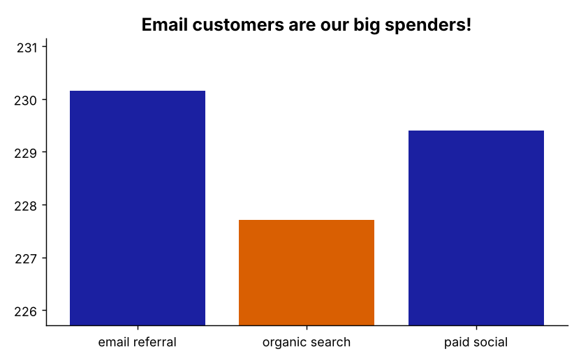

# Workshop: Data Literacy

#### <i>Using Data To Make Intelligent Decisions</i>

 <h2>4 - See What Happened</h2>

| Minutes | What happens |
|---|---|
| 0 to 8 | Lecture: counts, totals, rates, and change |
| 8 to 15 | Activity 1: The Headline Numbers |
| 15 to 25 | Lecture: the middle, the spread, and the shape of data |
| 25 to 34 | Activity 2: What's a Typical Order? |
| 34 to 42 | Lecture: showing data well |
| 42 to 48 | Activity 3: Show the Season, Spot the Trick |
| 48 to 50 | Skeptic's checkpoint: points or percent? |

> **Starting here?** You need the Lantern Peak case files (the `case-data` folder). This module uses the cleaned files in `clean_csv`, `supplements/anscombe.csv`, and `raw/finance_monthly_revenue.csv`. Quick catch-up: Lantern Peak Supply Co. is a fictional online retailer of camping and hiking gear, and its leadership team wants to understand what happened in 2025 before deciding where to spend $150,000 next year. One table matters here more than the others: `orders` has one row per order. You can do this module in any spreadsheet, and the same steps work in a query language or a notebook.

You have the alphabet (Modules 01 and 02) and your tools (Module 03). Now you start to read. *Descriptive* analysis is the simplest kind, and it's the one you'll do most: it answers the question **what happened?** It looks only at the data you have, and it summarizes it so a human can take it in. It won't tell you why something happened (that's Module 06), or what will happen next (Module 07). But every one of those later steps stands on a sound description, so it's worth doing carefully.

 <h2>4.1 Counting, Totals, Rates, and Change</h2>

Most descriptions come down to a handful of moves.

- **Count** how many (orders, customers, returns).
- **Sum** how much (revenue, refunds).
- **Average** the typical amount (more on that word in 4.2).
- **Rate** how often something happens relative to the number of chances: the return rate is returned lines divided by shipped lines.
- **Ratio** one measure divided by another: average order value is revenue divided by orders.
- **Change** how much something moved. Percent change is (new minus old) divided by old.

**Use rates to compare groups of different sizes, and always show the denominator.** Fifty returns sounds like a lot until you learn it came out of 20,000 shipped lines. A rate with no count behind it hides the opposite problem. A 100 percent return rate on three orders tells you almost nothing.

**Write the definition down.** "Customers" could mean everyone in the database or only the ones who ordered this year. "Revenue" could mean demand (what customers ordered) or recognized revenue (what finance counted, as you learned in Module 02). A good number travels with its definition: what's counted, over what period, from which source, and by which date field (order date or ship date).

**Compare like with like.** Compare a full year with a full year, a quarter with the same quarter last year, and never a holiday month with the month after it. A partial period will always look smaller than a full one.

<b>Activity 1: The Headline Numbers</b>

The CEO asks for a one-page summary of 2025 against 2024. You'll compute the headline numbers and write down exactly what each one means.

<b>Steps</b>

**Hands-on:**

1. Open `case-data/clean_csv/orders.csv`. Keep only rows where `status` is shipped.
2. For 2024 and for 2025 (using the year of `order_date`), compute: the number of orders, the merchandise revenue (the sum of `order_total`), the average order value (revenue divided by orders), and the number of different customers who ordered.
3. From `customers.csv`, count the new customers in each year (using `acquired_date`).
4. Work out the percent change from 2024 to 2025 for each measure.
5. For each measure, write a one-sentence definition. Say whether it's a count, a sum, a ratio, or a rate.
6. Open `raw/finance_monthly_revenue.csv` and total the 2025 months. Your revenue number won't match it. Write one sentence on why that's fine (hint: Module 02).

**Leader's view:** Open the scorecard below. It's what your team might hand you. Find what's missing. (Think: definitions, the source for each number, the period, and the comparison.) Then ask your team to add those before the scorecard goes in a deck.

<b>The scorecard your team sends you</b>

| Measure | 2024 | 2025 | Change |
|---|---:|---:|---:|
| Orders | 5,070 | 7,710 | +52% |
| Revenue | $1,454,322 | $2,227,864 | +53% |
| Average order value | $286.85 | $288.96 | +1% |
| Customers | 3,098 | 4,551 | +47% |
| New customers | 2,300 | 2,800 | +22% |

 <h2>4.2 The Middle, the Spread, and the Shape of Data</h2>

The next question is: what's a *typical* value, and how much do values vary? A single number answers the first part, and it's tempting to stop there. Don't.

**Three kinds of "average."**

- The *mean* adds everything up and divides by the count.
- The *median* is the middle value when you line the values up in order. Half the values are above it and half below.
- The *mode* is the most common value.

When the data is lopsided (*skewed*), the mean gets pulled toward the long tail and the median doesn't. Think of ten homes on a street. Nine sell for about $300,000 and one mansion sells for $4 million. The mean is $670,000, a price that none of the homes sold for, and the median is about $300,000. Income, order values, and time-to-resolve are all lopsided in the real world, so the median is often the better summary. Neither is wrong. The mistake is not saying which one you used.

**How spread out is it?** Four tools:

- The *range* is the smallest to the largest value, and it's very sensitive to a single extreme.
- *Percentiles* tell you the value below which a given share of the data falls. The 25th, 50th (the median), and 75th percentiles are the *quartiles*. The distance between the first and third quartiles is the *interquartile range*, and it describes the middle half of the data.
- The *standard deviation* is a measure of the typical distance between a value and the mean. A small one means values cluster tightly, and a large one means they're scattered.
- A *histogram* shows the whole shape at once: you split the values into bins and count how many fall in each.

**Outliers.** A value far from the rest might be an error (a typo, a test record), or a real but unusual case, or a hint that you're mixing two different populations. Find it, investigate it, and decide what to do with it, then write the decision down. Deleting an outlier because it's inconvenient is how analysts fool themselves.

**Always look at the picture.** In 1973, the statistician Francis Anscombe built four small datasets that have nearly identical means, spreads, and correlation, and look completely different when you draw them. [This page](https://en.wikipedia.org/wiki/Anscombe%27s_quartet) describes them. The lesson stays with you: numbers summarize, and summaries can hide the very thing you needed to see.

<b>Activity 2: What's a Typical Order?</b>

The CEO says, "Our average order is about $283." You'll find out what that really tells you.

<b>Steps</b>

**Hands-on:**

1. Using the shipped orders from Activity 1 (all years), compute the mean, median, 25th percentile, 75th percentile, minimum, and maximum of `order_total`. Which is larger, the mean or the median? Why?
2. Build a histogram of `order_total` with bins about $50 wide. Describe its shape in one sentence.
3. Add the customer type to each order (look it up in `customers.csv`) and recompute the mean and median for consumers and for wholesale customers. What changes? (If you're short on time, skip this step.)
4. Open `supplements/anscombe.csv`, which holds four datasets of x and y values. For each dataset, compute the mean of x, the mean of y, and the correlation between them (your spreadsheet's correlation function will do this). What do you notice?
5. Now draw a scatter chart for each of the four datasets. What changed your mind?

**Leader's view:** Whenever a report says "average," ask two questions: *Which average?* and *What does the spread look like?* Ask your team to show you the histogram next to the average. A good analyst welcomes the question, because the picture often tells a better story than the number.

 <h2>4.3 Showing Data Well</h2>

You communicate descriptive analysis mostly through pictures, and a good picture comes from picking the right kind of chart for your question, and then drawing it honestly.

| Your question | A good starting chart |
|---|---|
| How did something change over time? | Line chart |
| How do categories compare? | Bar chart (sorted, starting at zero) |
| What does the distribution look like? | Histogram or box plot |
| Do two measures move together? | Scatter chart |
| What are the parts of a whole? | A simple bar or stacked bar (a pie chart is fine for two or three parts, and hard to read for more) |
| Do I need the exact values? | A table |

**Axes.** Bars encode their value in their length, so a bar chart's axis should start at zero. If it doesn't, the picture exaggerates every difference. A line chart can start elsewhere, but say so. Label your units, and use the same scale when you compare several small charts side by side.

**Design.** Write a title that says what to notice. Label lines and bars directly where you can, and use few colors. Make the chart readable for everyone: choose a color-blind-friendly palette, don't rely on color alone, give the chart a text description for screen readers, and keep contrast high.

**Time and seasonality.** Data over time has three ingredients: a *trend* (the long-run direction), *seasonality* (a pattern that repeats on a calendar, like Lantern Peak's holiday peak), and *noise* (random wiggle). To spot them, line up the same months from different years. Never judge December against January in a business with a December peak.

**Ways charts mislead.** A truncated axis, a cherry-picked time window, two vertical axes that let you imply any relationship you like, 3D effects that distort size, and missing sample sizes. Few people mislead on purpose. Most charts mislead because the default settings made the story look better than the data supports.

<b>Activity 3: Show the Season, Spot the Trick</b>

You'll draw one honest chart from scratch, and then take apart a chart that isn't.

<b>Steps</b>

**Hands-on:**

1. From `raw/finance_monthly_revenue.csv`, draw a line chart of net revenue with the months January through December along the bottom and one line for each year. What do you notice? What share of each year's revenue arrives in November and December?
2. Look at the chart below. It comes from the marketing team's weekly email.

   

   Write down at least three things that could mislead a reader.
3. Compute the real average order value for each acquisition channel (consumer orders only; join `orders.csv` to `customers.csv` on `customer_id`, then look at `acquisition_channel`). Chart it with a bar chart that starts at zero. How different are the three channels, really?

**Leader's view:** The next time a chart lands on your desk, run this four-point check in under a minute: *the axis* (where does it start?), *the units* (what's being measured?), *the period* (is it a fair window?), and *the n* (how many observations are behind it?). Ask for a redraw if any one fails.

<b>Skeptic's Checkpoint: Points or Percent?</b>

A report says, "Returns are up 40 percent." You dig in and find the return rate rose from 5 percent to 7 percent. Both statements are true. The first sounds like an emergency, and the second sounds like a small drift. **Do this now (two minutes):** write down both ways to state the change. In the second one, the rise is **2 percentage points**, and in the first, it's a **40 percent** increase (2 divided by 5). Which would you quote, and what would you want to know about the denominator before you decided?

<b>Go Further (Optional): Adventure Works Cycles</b>

Adventure Works Cycles sells through two channels: Internet (direct to individuals) and Reseller (business partners and stores). In `case-data/adventure-works` you'll find an invented extract. (Read its README first. The numbers are illustrative, and none come from a real financial statement.)

**Steps:**

1. Compare the two channels on the number of orders, the revenue, the average order value, and the gross margin percentage. Revenue for a line is `quantity * unit_price * (1 - discount)`. Gross margin is revenue minus `quantity * standard_cost`, divided by revenue.
2. Which channel has more orders? Which earns more revenue? Which has the better margin?
3. Write two sentences that describe the channels to a new executive. What would you want to ask next? (That question is where Module 06 begins.)

<b>Instructor notes</b>

**Timing (50 minutes).** Lecture 4.1 for 8 minutes, Activity 1 for 7, lecture 4.2 for 10, Activity 2 for 9, lecture 4.3 for 8, Activity 3 for 6, checkpoint for 2. The optional Adventure Works activity isn't in the 50.

**Talk track.**
- This is the "basics" module. Stay concrete, and keep tying each idea to a Lantern Peak number.
- On 4.1, make "write the definition down" the main idea. Ask the room how many definitions of "customer" they carry around (a callback to Module 01).
- On 4.2, use the house-price example for the mean and median, then show Lantern Peak's real gap ($283 against $193). Draw a skewed distribution on a whiteboard and mark the mean and median.
- For Anscombe, have learners compute the statistics first and chart second. The surprise is the point, so don't show the image early. When you reveal it, use `images/anscombe_quartet.png`.
- On 4.3, keep the focus on the question each chart answers: "What question is this chart answering?"

**Answer key, Activity 1.**

| Measure | 2024 | 2025 | Change | Type |
|---|---:|---:|---:|---|
| Shipped orders | 5,070 | 7,710 | +52% | count |
| Revenue (sum of order_total) | $1,454,322 | $2,227,864 | +53% | sum |
| Average order value | $286.85 | $288.96 | +1% | ratio |
| Customers who ordered | 3,098 | 4,551 | +47% | count |
| New customers | 2,300 | 2,800 | +22% | count |

Finance's 2025 net revenue is $2,019,057 (up 54 percent on 2024). The two differ because the order-system figure is demand by order date before refunds, and finance counts shipments net of refunds (the bridge from Module 02). Strong teaching point: orders and revenue grew about 52 to 53 percent, but average order value barely moved. The growth came from more orders and more customers, and not from bigger baskets.

**Answer key, Activity 2.**
- All shipped orders: mean $282.76, median $193.46, 25th percentile $114.41, 75th percentile $325.43, minimum $8.81, maximum $6,689.71, standard deviation about $356. The mean is larger than the median because a small number of very large orders pull it up.
- Histogram: heavily right-skewed. About 78 percent of orders fall under $350 (the tallest bar is the $100 to $150 bin), with a long thin tail: only about 3 percent of orders top $1,000, and they're mostly wholesale.
- By customer type: consumers have a mean of $228.75 and a median of $182.16. Wholesale orders (604 of them) have a mean of $1,617.40 and a median of $1,474.47. The two groups are different populations, and mixing them produces an "average" that describes neither.
- Anscombe: all four datasets have a mean x of 9.00, a mean y of 7.50, and a correlation of about 0.82. The scatter charts show a roughly linear cloud, a clean curve, a line broken by one outlier, and a vertical stack with a single point at x=19.

**Answer key, Activity 3.**
- Line chart: every year shows the same shape, with a peak in November and December. The share of each year's net revenue earned in those two months is about 30 percent in 2023 and 2024 and 27 percent in 2025. (The first year, 2023, started from zero in January, so growth inflates its share a little.)
- The misleading chart: the axis starts at 226 and tops out at 231, there are no units, the headline claims a result the data doesn't support, and one bar is colored differently from the other two, which draws the eye. (Another point is that nothing tells you the sample size.)
- The real averages: email referral $230.15, organic search $227.71, paid social $229.40. The channels sit within $2.44 of each other, about 1.1 percent. Reveal `images/aov_channel_honest.png` to show the same data with a zero baseline.

**Answer key, checkpoint.** Both statements are true. A rise from 5 to 7 percent is 2 percentage points, or a 40 percent increase. Quote both together ("up 2 points, from 5 to 7 percent") and ask for the denominator.

**Answer key, Go Further.**

| Channel | Orders | Revenue | Average order value | Gross margin |
|---|---:|---:|---:|---:|
| Internet | 5,026 | $4,445,482 (26%) | $884 | 36.4% |
| Reseller | 1,574 | $12,605,393 (74%) | $8,009 | 30.9% |

Internet has about three times the orders, and Reseller earns about three times the revenue. Reseller orders are roughly nine times larger, and Reseller's margin is lower, because of discounts. Good "next questions" include: does the margin gap come from discounts or from product mix? Which territories rely most on Reseller? (Those questions are diagnostic, and they lead into Module 06.)

**Common pitfalls.** Learners mix the order date and the ship date. Learners compute the mean of a column that includes cancelled orders. Learners forget to join customer type before splitting wholesale from consumer. Percentage points and percent get confused (that's what the checkpoint is for).

**If you need to cut time.** Skip step 3 in Activity 2 and give the consumer and wholesale figures as a handout.

<b>For Further Study</b>

<ul>
 <li><a href="https://en.wikipedia.org/wiki/Anscombe%27s_quartet" target="_blank">Anscombe's quartet</a></li>
 <li><a href="https://www.khanacademy.org/math/statistics-probability" target="_blank">Khan Academy: Statistics and probability</a> (mean, median, spread, and distributions)</li>
</ul>

<b>Next Steps</b>

Next, continue to <a href="05-the-skeptics-toolkit.md"><i>Module 05 - The Skeptic's Toolkit</i></a>.
