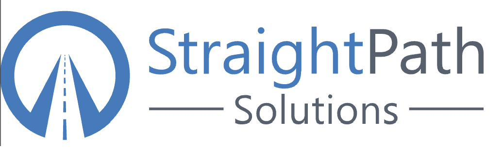

# Workshop: Data Literacy

#### <i>Using Data To Make Intelligent Decisions</i>

 <h2>9 - Explain, Act, Learn</h2>

| Minutes | What happens |
|---|---|
| 0 to 5 | Lecture: explaining a decision so people can act on it and check it |
| 5 to 13 | Activity 1: Write the One-Page Decision Brief |
| 13 to 16 | Lecture: acting, and learning from what happens |
| 16 to 19 | Activity 2: Decision Log and Post-Mortem Plan |
| 19 to 20 | Closing checkpoint: could a stranger reproduce it? |

> **Starting here?** You can do this module without the earlier ones. The "case file" in Module 08, Activity 1 summarizes what the analysis found. If you only have a minute to catch up: Lantern Peak Supply Co. is a fictional online retailer of camping and hiking gear, its leadership team has $150,000 to spend next year, and the analysis recommends a staged plan, spending about $65,000 on two controlled tests and holding the rest, because the payoff of the biggest option depends on a number nobody has measured yet.

When you learned to read, the last step was to write something of your own that other people could understand. This is that step. You've found data, trusted it, worked with it, described it, challenged it, explained it, predicted from it, and chosen an action. Now you have to tell someone, and then find out whether you were right.

 <h2>9.1 Explain the Decision</h2>

Even when you're using data to decide something for yourself, be ready to explain it to someone else. It's the last check you make before you act, because an argument you can't explain clearly is often one you don't fully understand. When the decision affects other people, explain it to as many of them as you can: in an email, a one-page brief, a short deck, a notebook, or a chart.

**Write for the decision-maker.** Put the answer first. People with limited time want to know what you recommend, why, how sure you are, and what you need from them. They can read the details afterward.

A good one-page decision brief has these parts:

1. **The decision requested.** One sentence on what you need them to decide.
2. **The recommendation.** One or two sentences, in plain words.
3. **Why.** Three evidence points, each with a number, a definition, and a source. Use a single chart if it helps.
4. **Options considered.** A short table, including doing nothing, and why you didn't choose the others.
5. **Risks and unknowns.** What could be wrong, and a *range* for the numbers that matter.
6. **How we'll know.** What you'll measure, when you'll review it, and what result would make you stop.
7. **Sources and methods.** A pointer to your source log, your cleaning log, and your definitions, so someone else can check your work.

**Show your uncertainty.** Say "about $450,000, with a range of $390,000 to $510,000" and not "$451,208." Use words like "likely" and "we don't yet know" when they're true. Decision-makers trust a person who tells them what is uncertain much more than one who hides it.

**Document so others can reproduce it.** Anyone who reads your brief should be able to find the data, follow your steps, and get your number. That lets people debate, include others, and catch errors. It's also what lets *you* repeat the work next quarter without starting over.

**A word on AI assistants.** An assistant can help you outline, tighten wording, and find the clearest chart. Treat what it drafts the way you'd treat a colleague's first pass. Check every number against your own work, and don't let it add facts you haven't verified. Don't paste confidential data into a tool your organization hasn't approved.

<b>Activity 1: Write the One-Page Decision Brief</b>

You'll write the brief that goes to Lantern Peak's CEO and leadership team.

<b>Steps</b>

**Hands-on:**

1. Open the "case file so far" table in Module 08 (Activity 1). Use the results from your own work in Modules 05 through 08 where you have them.
2. Write a one-page brief using the seven parts above. Keep it to a page. If you must choose between more detail and clarity, choose clarity.
3. Check that every number in the "Why" section has a *definition* (what exactly is counted) and a *source* (where it came from).
4. Read it once more as the CEO. Is the recommendation in the first two lines? Is it clear what you want them to do?

**Leader's view:** You've been handed this draft brief. Read it, and find as many problems as you can. (There are at least six, and each one connects to a module.) Then decide what you'd ask the author to fix before it goes to the board.

> **Recommendation:** Put the full $150,000 into paid social.
>
> Revenue is up and paid social is working. Our customers love us (94 percent are satisfied), loyalty members spend twice as much as everyone else, and email drives sales. The average order is $283. Our AI tool says we'll do $451,208.37 next quarter, so we have plenty of room.

<b>Reveal the problems in the draft</b>

1. **"94 percent are satisfied."** It's a survey with a 9 percent response rate, and the people who answered were less likely to have returned an item (non-response bias, Module 05).
2. **"Loyalty members spend twice as much."** They were already spending about 1.5 times as much before the program started (self-selection, Module 05).
3. **"Email drives sales."** Email and revenue both follow the holiday season. Year over year, the correlation is about 0.10 (confounding, Module 06).
4. **"The average order is $283."** That's the mean. The median is $193, and wholesale orders pull the mean up (Module 04).
5. **"$451,208.37."** False precision. A backtest of this kind of forecast misses by about 13 percent. And "our AI tool says" gives no method or range (Module 07).
6. **"Paid social is working."** Paid social customers repeat at about half the rate of others, and the case depends on how many were truly new (incrementality). No break-even is shown (Modules 06 and 08).
7. **No range, no sources, no kill criteria.** The brief doesn't say how sure it is, where the numbers came from, or what would make the team stop.

 <h2>9.2 Act and Learn</h2>

A decision is finished when someone *does* it and you find out what happened.

**Make it actionable.** For each step of the plan, name an *owner*, a *date*, and a *measure*. "Marketing will run the test" is a wish. "Dana will run the 60-day paid social test starting March 3 and report incremental customers per region on May 5" is a plan.

**Keep a decision log.** A *decision log* is a short record, written at the time of the decision, that captures what you decided and why. It should list the date, the decision, the options considered, the rationale, the key assumptions, what you expect to happen, the owner, the review date, and the kill criteria. It's the antidote to hindsight, because later you can see what you *actually* believed and not what you now remember believing.

**Learn from what happens.** No matter how careful you are, you'll sometimes be wrong. That's normal, particularly for people who make big decisions often. What matters is learning from it and feeding what you learn into the next decision. The tool for that is a *post-mortem* (some teams call it a retrospective), a short, *blameless* review of what you expected, what really happened, what went well, what went poorly, and what you'll do differently. A post-mortem takes time, so teams often skip it, and that saving is an illusion. Repeating a costly mistake is far more expensive than an hour spent understanding it.

Compare your forecasts with what happened, too. Whether your range held is one of the best calibration tools you have.

<b>Activity 2: Decision Log and Post-Mortem Plan</b>

<b>Steps</b>

**Hands-on:**

1. Write the decision log entry for your recommended plan: *date, decision, options considered, rationale, key assumptions, what you expect to happen, owner, review date, and kill criteria.*
2. Set two review dates (for example, 60 days and 6 months). For each, write what you'll compare: what you expected against what happened.
3. Finish this sentence: *"The mistake I'm most afraid of making with this decision is..."* Then write what you'd check to catch it early.

**Leader's view:** Ask your team whether your last big data-driven decision has a log entry and a review date. If it does, read the entry and ask what has been learned since. If it doesn't, start one for the next decision.

<b>Closing Checkpoint: Could a Stranger Reproduce It?</b>

One last skeptic's question, and it's the one that ties the whole workshop together. **If someone you've never met opened your brief tomorrow, could they find your data, follow your steps, and arrive at your numbers?** If not, what is missing? (Probably one of these: the source log, the cleaning log, the definitions, or the queries.) Write down the one thing you'd add.

Then write down **one habit** from this workshop that you'll use in the next week. Make it small enough that you'll actually do it.

You've now followed the whole path: the alphabet (data), the tools you write with, the grammar (describing, doubting, and explaining), and the meaning (predicting, deciding, and explaining your decision). Data literacy is a habit of asking good questions of the numbers in front of you, and you've just practiced it from start to finish. If there's one thing the world needs more of, it's people who make wise decisions with care for everyone those decisions affect, and data literacy is a way to do exactly that.

<b>Instructor notes</b>

**Timing (20 minutes).** Lecture 9.1 for 5 minutes, Activity 1 for 8, lecture 9.2 for 3, Activity 2 for 3, closing for 1. This module is short on purpose. If you have more time, extend Activity 1 and let learners swap and critique each other's briefs.

**Talk track.**
- Open by saying that this is the step most analysts skip: the explaining. A good analysis that nobody understands changes nothing.
- Keep the one-page limit firm. Constraint creates clarity.
- Use the draft brief as a team game: "Find the six problems in 90 seconds." Every problem points to a module, which makes a good recap.
- For the post-mortem, ask who has ever been in a project review that turned into a hunt for someone to blame. Then describe the "blameless" version.
- Close by having each learner say their one habit aloud. It makes commitments stick.

**A model brief (for comparison, not for distribution before the activity).**

> **Where to put $150,000 in 2026**
>
> **Decision requested:** Approve a staged plan for the 2026 growth budget.
>
> **Recommendation:** Don't commit the full $150,000 to paid social. Spend about $65,000 now on two controlled tests ($50,000 on paid social and $15,000 on a retention pilot), and hold the other $85,000 until the results arrive in about 60 days.
>
> **Why:**
> 1. *Growth is real, but the quality of new customers is shifting.* Net revenue grew 54 percent in 2025. The share of new customers who buy again within 90 days fell from 38.5 to 34.7 percent, because paid social (20 to 23 percent repeat) grew to about half of new customers. Every channel's own repeat rate rose.
> 2. *Paid social pays back only if at least about 62 percent of its customers are new business.* It costs about $98 per customer and earns about $157 in gross profit over a year. We haven't measured how many of those customers we'd have won anyway. The expected value is positive (about $26,000), but the range runs from a $73,000 loss to a $118,000 gain.
> 3. *The alternatives don't pay on today's evidence.* A retention program needs about a 7 percent lift in spending, and our best evidence (loyalty members) suggests about 7 points at most, from people who chose to join. Fit tools can recover at most about $19,800 a year against a $30,000 cost. The churn vendor's 95 percent accuracy matches a model that predicts nobody leaves, and it catches 30 percent of leavers.
>
> **Options considered:** A (all paid social), B (retention), C (fit tools), D (reserve), and E (this plan).
>
> **Risks and unknowns:** Incrementality is unmeasured. Cost per customer may rise as we spend more. Loyalty evidence is confounded. Q1 2026 revenue is forecast at roughly $390,000 to $510,000.
>
> **How we'll know:** At day 60, the paid social test (with regions held out as a control) scales if the measured incremental share is at least 62 percent and stops otherwise. The retention pilot (with a random holdout) scales only if the measured lift is at least 7 percent. Review again at six months.
>
> **Sources and methods:** Source log, cleaning log, and definitions are in the project folder. Figures come from the finance report and the order system, reconciled to the cent for 2023 through 2025.

**Rubric for a brief (one point each, six in all).** The recommendation is in the first two lines. Every number has a definition and a source. At least one number carries a range. Doing nothing (or waiting) appears as an option. There is a measurable stop rule with a number. Sources and methods are referenced.

**Answer key, Activity 2.** A decision log entry for the staged plan: the date, the decision (staged plan, about $65,000 now, $85,000 held), the options considered (A through E), the rationale (break-even 62 percent, spread of outcomes), the key assumptions (incrementality, cost per customer, 12-month gross profit), the expectation (the test shows whether paid social clears 62 percent), the owner, a review at 60 days and at six months, and the kill criteria. The "mistake I'm most afraid of" answers vary. Good ones name something checkable (for example, declaring the test a success because the number looked good on a small sample).

**Common pitfalls.** Briefs run to two pages. Learners put the recommendation at the end. Numbers appear without definitions. The brief hides uncertainty or leaves out doing nothing. Learners write a post-mortem plan that is really a blame list.

**If you need to cut time.** Run Activity 1 as a pair exercise on only the recommendation and the "Why" section. Do Activity 2 as a discussion.

<b>For Further Study</b>

<ul>
 <li><a href="https://www.khanacademy.org/math/statistics-probability" target="_blank">Khan Academy: Statistics and probability</a></li>
 <li><a href="https://otexts.com/fpp3/" target="_blank">Forecasting: Principles and Practice</a> (a free online textbook)</li>
 <li>Books worth your time: <i>How to Measure Anything</i> (Hubbard), <i>Thinking, Fast and Slow</i> (Kahneman), and <i>Noise</i> (Kahneman, Sibony and Sunstein)</li>
 <li>Your own library: a research librarian can help you find and evaluate sources in almost any field</li>
</ul>

<b>Congratulations</b>

You've completed this workshop on Data Literacy. You now have the habits, the tools, and the process you need to apply this to your own data and your own decisions. Return to the <a href="00-start-here.md"><i>start</i></a> any time, and take any module on its own.
